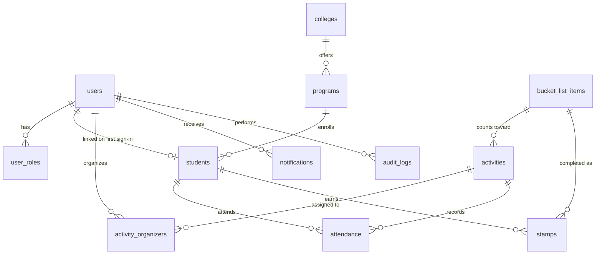

# Database ERD

MySQL (InnoDB, `utf8mb4`). All times are stored in **UTC**. The schema is created by migrations in
[`backend/src/database/migrations`](../backend/src/database/migrations).



## Tables

| Table | Purpose | Key rules |
| --- | --- | --- |
| `users` | Everyone who has signed in with Microsoft 365 | Unique `entra_oid` (Microsoft's stable id) and `email`. `is_active = 0` blocks sign-in. |
| `user_roles` | Roles held by each user | Synced from Entra app roles at every sign-in: `Student`, `Organizer`, `Admin`, `ITAdmin` |
| `colleges`, `programs` | Academic structure | Used to filter reports by college and program |
| `students` | Student records (imported from the Student Portal) | Unique `student_number` and `email`. `user_id` is set automatically on the student's first sign-in (matched by email). |
| `bucket_list_items` | Pre-identified experiences | `required_count` = verified activities needed to complete one |
| `activities` | University activities eligible for crediting | Optional link to a bucket list item; `ends_at > starts_at` |
| `activity_organizers` | Organizers assigned to each activity | Organizers manage and scan only their assigned activities |
| `attendance` | One row per student per activity | **Unique (activity, student)** = duplicate-entry safeguard. `pending` → `validated` / `invalidated`; `qr` or `manual` |
| `stamps` | Digital stamp per completed experience | Unique (student, bucket list item); `revoked_at` if the attendance is invalidated |
| `notifications` | Messages to users | Credited activity, new stamp, milestone |
| `audit_logs` | Who did what, when and why | Sign-ins, manual validation (with `justification`), role changes, imports |
| `schema_migrations` | Migrations already applied | Managed by `npm run migrate` |

## What happens at sign-in

In one transaction ([`users.repository.js`](../backend/src/modules/users/users.repository.js)):

1. Find the user by `entra_oid`. If deactivated, refuse sign-in and log `auth.sign_in_blocked`.
2. Insert the user (first sign-in) or update their email, name and `last_login_at`.
3. Sync `user_roles` with the roles from Microsoft.
4. Link the imported `students` row with the same email, if not linked yet.
5. Log `auth.sign_in` in `audit_logs`.

## Migrations

```bash
cd backend
npm run migrate          # apply new migration files
npm run migrate:status   # list applied / pending
```

Never edit a migration that has already run. Add a new numbered file (`002_add_x.sql`) instead.
